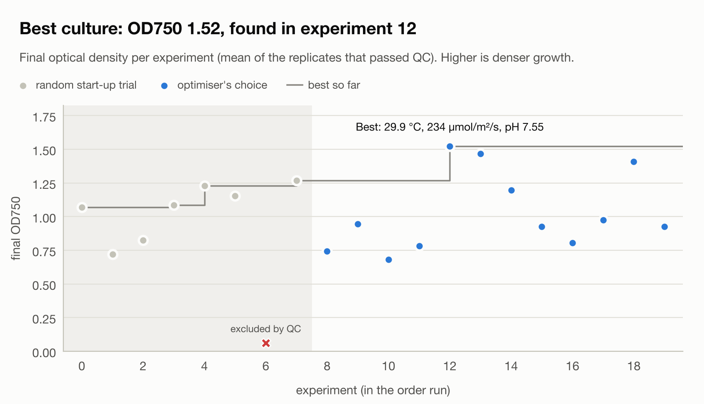
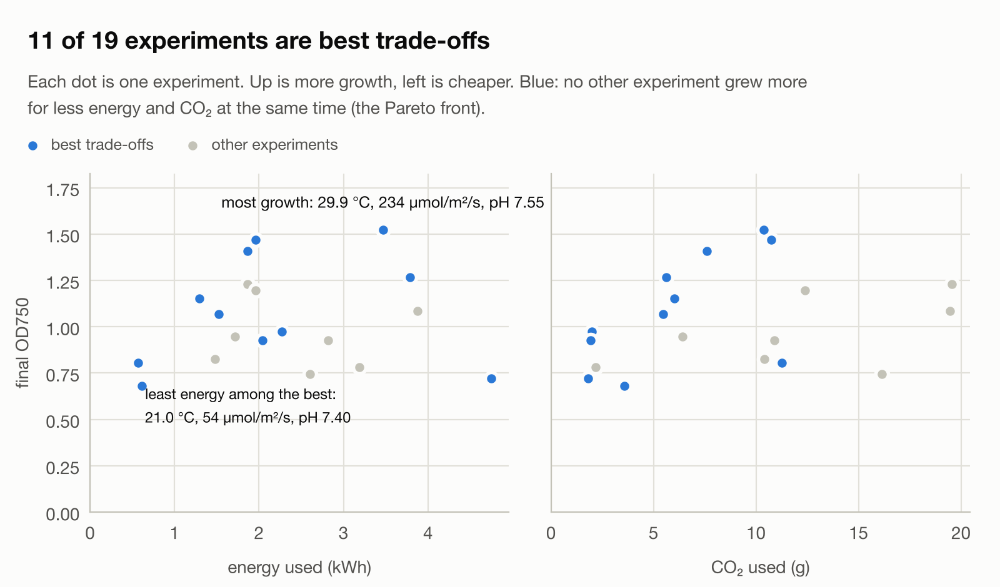
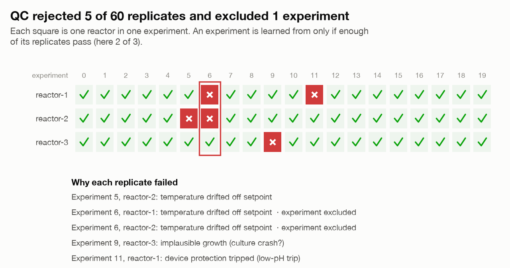

# algae-sim

[](https://github.com/stev004/algae-sim/actions/workflows/ci.yml)

**A simulated algae photobioreactor that behaves like lab hardware, so a closed-loop lab system can be built and tested before any hardware exists.**

It plugs into [AutoLab](https://github.com/stev004/autolab), a closed-loop experimentation platform, through the same interfaces a real bioreactor would use:

- AutoLab's optimiser proposes growth conditions: temperature, light and pH.
- The device declares its controlled variables, ranges and protection limits; AutoLab reads them rather than assuming them (AutoLab's culture contract v2).
- AutoLab validates them and sends a bounded setpoint command to each replicate reactor.
- The reactor's own on-device controller holds those conditions while AutoLab polls telemetry and OD750 readings.
- AutoLab QCs every replicate, learns from the passing ones and records everything as evidence.

AutoLab never touches the heater or the CO2 valve: the device owns its own control and protection. pH is a setpoint the device holds by dosing CO2, and the CO2 it uses is metered like energy.

One demo campaign: 20 experiments × 3 replicate reactors = 60 simulated 36-hour cultures, in seconds. The charts are drawn from AutoLab's own evidence database.

<picture>
  <source media="(prefers-color-scheme: dark)" srcset="docs/images/progress-dark.png">
  
</picture>

<picture>
  <source media="(prefers-color-scheme: dark)" srcset="docs/images/tradeoffs-dark.png">
  
</picture>

<picture>
  <source media="(prefers-color-scheme: dark)" srcset="docs/images/qc-dark.png">
  
</picture>

> Growth parameters are drawn from published *Chlorella vulgaris* literature, with every source and its confidence listed in [the model notes](docs/model.md#where-the-numbers-come-from). They are literature-typical values, not a fit to one strain; the carbonate buffer is still illustrative. The model is **not validated**; nothing here predicts real algae behaviour. AutoLab's evidence marks every reading as coming from a simulated sensor.

## Quick start

Needs [uv](https://docs.astral.sh/uv/). uv fetches Python 3.12 and a pinned AutoLab commit itself.

```sh
git clone https://github.com/stev004/algae-sim.git && cd algae-sim
./scripts/demo.sh            # full AutoLab culture campaign → charts in runs/demo/charts/
uv run pytest                # tests, including an end-to-end campaign
```

**The reactor as a real device.** Run the reactor bank as its own long-running service. Then crash AutoLab partway through a culture and watch it resume:

```sh
./scripts/resume_demo.sh              # SIGKILL AutoLab 13 h into a 36 h hold, restart, resume
OUTAGE_S=60 ./scripts/resume_demo.sh  # a long outage: AutoLab resumes, but QC rejects the run
```

**The data pipeline.** Capture → move → parse/validate → store → analyse, locally:

```sh
./scripts/pipeline_demo.sh   # pipeline down mid-campaign, backlog drains, replay dedupes,
                             # bad lines quarantined, its flags match AutoLab's QC
```

Or by hand:

```sh
uv run python -m algae_sim device serve --speed 900 --settings configs/device-settings.json --state runs/device
uv run python -m algae_sim device status          # in another terminal
```

then point a campaign at it with `configs/culture-device.yaml`.

One reactor batch on its own, with a plot:

```sh
uv run python -m algae_sim run --setpoint 30 --light 150 --plot runs/batch.png
uv run python -m algae_sim run --heater-fails-after 6 --plot runs/heater-fail.png
```

## What it demonstrates

| Idea | Where |
|---|---|
| **True state, measurement, decision and actuation kept separate.** Controllers and AutoLab only ever see noisy, quantised sensor readings | `reactor.py`, `instruments.py` |
| **The device owns safety.** An on-board thermostat with a fail-safe on lost readings and a latching over-temperature trip, and a pH controller that doses CO2, closes the valve on a lost reading and shuts the supply off on a low-pH trip, even past a stuck-open valve. Works with AutoLab disconnected | `control.py`, `instruments.py` |
| **Coupled variables, honestly modelled.** pH and CO2 aren't independent knobs: photosynthesis raises pH, CO2 lowers it, gas exchange pulls it towards air equilibrium. So a lower pH costs more CO2, and the optimiser trades growth against energy and CO2 | `carbon.py` |
| **A commandable-device adapter.** Declares named controlled variables, refuses commands that name unknown or missing ones, re-checks its own limits, acknowledges the values it actually applied, reports only attested telemetry, honours safe state, tracks the command it holds | `autolab/controller.py` |
| **A read-only instrument adapter.** OD750 probe with open, self-test and calibration checks, and identity-bound evidence | `autolab/sensor.py` |
| **Simulated time.** Follows AutoLab's clock, so a 36-hour hold runs in milliseconds; AutoLab refuses a skipping clock unless the device declares itself simulated | `autolab/controller.py` |
| **A device that outlives its client.** The reactor bank runs as its own HTTP service with persisted state. It keeps holding while AutoLab is down, and AutoLab resumes the hold after a crash | `device/service.py`, `scripts/resume_demo.sh` |
| **Honest failure semantics on a network.** "Never reached the device" is reported differently from "sent, no reply". Lost replies are resolved by resending the same command ID, which the device recognises and doesn't apply twice. Persistent silence is reported to AutoLab as ambiguous | `autolab/remote.py`, `device/core.py` |
| **Fault injection to prove QC.** Per-replicate heater failures, culture crashes and stuck CO2 valves. AutoLab's per-replicate QC and its 2-of-3 replicate rule catch them | `configs/culture-algae-sim.yaml` |
| **A data pipeline that can't lose or double-count.** The device logs what it measured, and a separate uploader buffers through outages and retries. The ingest keeps raw batches, validates every line, quarantines bad ones with a reason, and dedupes resends by device and sequence | `pipeline/`, `scripts/pipeline_demo.sh` |
| **Reproducibility.** Seeded instruments; each culture's seed is the device seed, the reactor and that reactor's culture number, so rerunning a campaign gives byte-identical evidence and charts | `reactor.py`, `device/core.py` |

The injected faults in the demo config:

| Experiment | Fault | AutoLab's verdict |
|---|---|---|
| 5 | reactor-2's heater fails at hour 4 | That replicate fails `temperature_control`; 2 of 3 pass, so the experiment counts |
| 6 | reactor-1's and reactor-2's heaters fail | Only 1 of 3 passes, so the experiment fails QC and isn't learned from |
| 9 | reactor-3's culture crashes at hour 12 | Contamination screen `growth_plausible` flags the OD drops; 2 of 3 pass |
| 11 | reactor-1's CO2 valve sticks open at hour 4 | The device trips on low pH and shuts off the CO2; AutoLab stops that replicate (`no_protection_trip`, `control:ph`); 2 of 3 pass |

## Layout

| Path | What it does |
|---|---|
| `algae_sim/thermal.py` | Heat balance of one well-mixed vessel |
| `algae_sim/growth.py` | Educational growth model: temperature, light and pH responses, photoinhibition, crowding, heat-stress death |
| `algae_sim/carbon.py` | Simplified pH/CO2 model: photosynthetic uptake, CO2 dosing, gas exchange; cardinal pH growth response |
| `algae_sim/instruments.py` | Noisy, quantised temperature, pH and OD750 sensors with dropouts; a heater and a CO2 valve that can fail |
| `algae_sim/control.py` | Hysteresis thermostat with fail-safe and over-temperature trip; pH controller with fail-safe and low/high pH trips |
| `algae_sim/reactor.py` | One step: sense → decide → actuate → physics; telemetry, energy, safe state, fault injection |
| `algae_sim/records.py` | `run.json` and `telemetry.jsonl`, the instrument-capture format |
| `algae_sim/device/` | Device firmware (`core.py`: reactor bank, limits, idempotent commands, device clock) and the HTTP device service (`service.py`) |
| `algae_sim/pipeline/` | Data pipeline: parse/validate, raw + clean stores, ingest endpoint, uploader, per-hold analysis |
| `algae_sim/autolab/` | AutoLab adapters: in-process (`controller.py`), over the network (`remote.py`), OD probe (`sensor.py`); campaign charts (`plot_campaign.py`); an earlier database-free optimiser loop (`campaign.py`) |
| `configs/` | Culture campaign and installation policy |
| `docs/` | [Architecture](docs/architecture.md), [model](docs/model.md), [data pipeline plan](docs/data-pipeline.md), [progress and decisions](docs/progress.md) |

## Roadmap

1. ✅ Reactor simulator: thermal, growth, sensors, controller, faults, reproducible run records.
2. ✅ AutoLab read-only sensor adapter and optimiser loop.
3. ✅ AutoLab stage-6 culture controller: replicates, telemetry, QC, contamination screens, evidence ledger. Migrated to culture contract v2 (named variables, pH held by CO2 dosing, CO2 metered).
4. ✅ The reactor as its own device process: an HTTP device service with persisted state; AutoLab survives a crash mid-culture and resumes the hold.
5. 🔶 Data pipeline: capture → move → parse → store → analyse. ✅ Local version; Azure version next ([plan](docs/data-pipeline.md)).

The code was written by AI coding agents under my direction; I designed the system, set the requirements, and reviewed and tested every change. Working agreement for contributors and AI assistants: [AGENTS.md](AGENTS.md).
