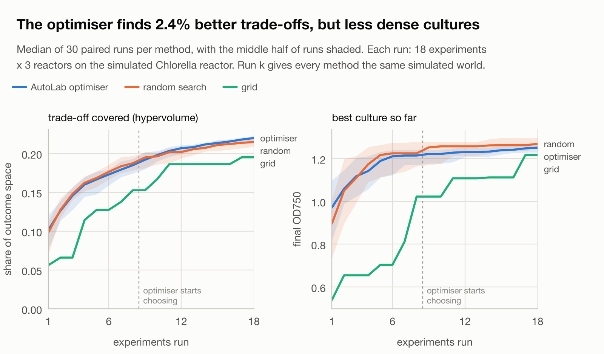
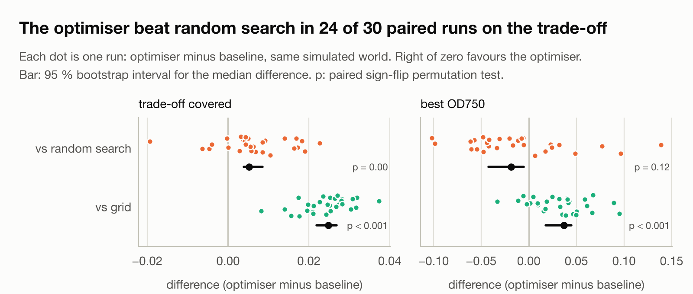
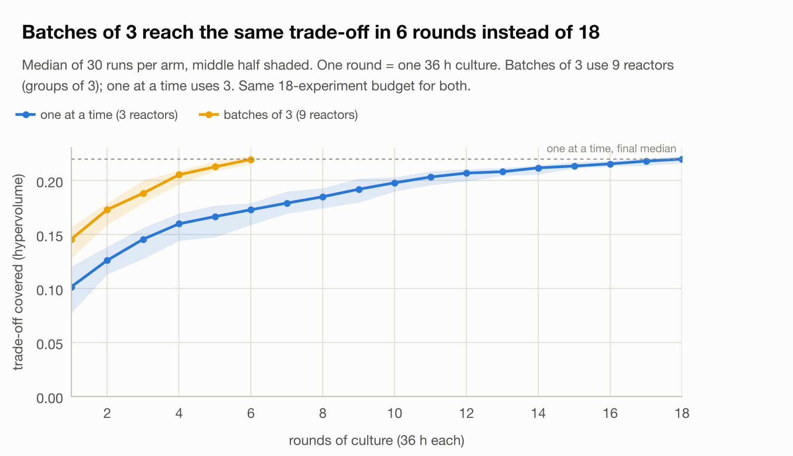

# Does AutoLab's optimiser beat random and grid search?

[Project overview](../README.md) · [Model](model.md) · [Architecture](architecture.md) · [Progress](progress.md)

**Short answer:** on the simulated *Chlorella* reactor, AutoLab's optimiser scores 2.9 % (median) higher than random search on hypervolume, the combined growth/energy/CO₂ score. That's small but consistent: it was better in 22 of 30 paired runs. **But the edge comes from cheap, low-yield cultures.** Count only cultures above OD 0.8 and it disappears. At a useful density the optimiser's cheapest culture is no cheaper, in kWh or grams of CO₂, than random search's. It doesn't find denser cultures either. It does beat a fixed grid clearly. Running the optimiser in **parallel batches of 3** (AutoLab stage 8) reaches the same result in **6 rounds of culture instead of 18**, within a ±1.2 % equivalence margin. This is a result about a simulator, and the limits section says why it may not hold on real hardware.

<picture>
  <source media="(prefers-color-scheme: dark)" srcset="images/benchmark-progress-dark.png">
  
</picture>

## The question

AutoLab chooses each culture's temperature, light and pH, aiming for high final OD750 at low energy and CO₂ use. Does its optimiser get there faster than simpler strategies, given the same small budget?

## How it was tested

- **Three methods, the same budget.** Each run is 18 experiments × 3 replicate reactors × 36 h.
  - **AutoLab optimiser:** 8 random start-up experiments, then Optuna's multi-objective TPE. The sampler is pinned to TPE.
  - **Random search:** AutoLab's `strategy: random`, uniform over the search space.
  - **Grid:** 3 temperatures (22, 28, 34 °C) × 3 light levels (60, 180, 400 µmol/m²/s) × 2 pH (6.5, 8.0), in AutoLab's lexicographic order. This uses the `grid_levels` option added to AutoLab for this benchmark.
- **30 paired runs.** Run *k* gives all three methods the same simulated world (device seed *k* + 1), so a difference within a pair comes from the strategy, not from luckier noise.
- **Independent seeds.** AutoLab seeds each trial's sampler with campaign seed + trial number, so neighbouring seeds would share most of their start-up designs (seed 11 repeats seed 10's, shifted by one trial). The seeds are spaced 1000 apart, more than the budget, and the pilot confirmed no two runs started alike. Fixing the seed derivation in AutoLab itself is in progress.
- **No injected faults.** This measures search, not quality control. Every experiment passed QC.
- **Main score: hypervolume.** This is the share of the outcome space (OD750 up; energy and CO₂ down) that a run's results dominate. Hypervolume is the standard score for multi-objective search, and the optimiser was asked to optimise all three goals, so scoring on OD alone would be unfair to it.
  - The reference point comes from device limits only, never from results: OD 0; 7.2 kWh, the heater plus lights flat out for 36 h; and 36 g CO₂, the valve open for 36 h.
  - The ideal is the OD sensor's ceiling of 4.0.
- **Second score:** the best OD750 found, which is easier to read.
- **Statistics:** distribution-free, because 30 paired differences need not be normal.
  - A paired sign-flip permutation test on the median difference (20,000 permutations, two-sided).
  - A 95 % bootstrap interval on the same median paired difference.
  - Until 2026-11-16 the permutation test used the *mean* difference while the headline and interval used the median. The p-values below are from the median version. The change moved hypervolume vs random from 0.0003 to 0.0007 and best OD from 0.31 to 0.38; no conclusion changed.

Running 90 campaigns takes about 7 minutes on 8 cores.

## Results

| Optimiser vs | Score | Optimiser better in | Median difference (95 % CI) | Relative | p |
|---|---|---|---|---|---|
| random search | hypervolume | 22 / 30 | +0.0062 (+0.0023 to +0.0114) | +2.9 % | < 0.001 |
| random search | best OD750 | 11 / 30 | −0.008 (−0.043 to +0.009) | −0.6 % | 0.38 |
| grid | hypervolume | 30 / 30 | +0.026 (+0.024 to +0.027) | +13.5 % | < 0.001 |
| grid | best OD750 | 26 / 30 | +0.032 (+0.022 to +0.045) | +2.7 % | 0.001 |

Relative differences are against the baseline's median. All three significant p-values stay below 0.01 after a Holm correction for the four tests. "< 0.001" means at or near the resolution of 20,000 permutations.

## Where the edge comes from

Hypervolume rewards *any* culture that's cheap, however thin. So it matters where in the outcome space the optimiser gains.

**Only counting cultures above a useful density:**

| Hypervolume counting only OD above | Optimiser vs random | Better in | p |
|---|---|---|---|
| 0 (the headline) | +2.9 % | 22 / 30 | < 0.001 |
| 0.8 | +1.3 % | 16 / 30 | 0.69 |
| 1.0 | +0.2 % | 15 / 30 | 0.81 |

These keep the original reference point and drop points below the threshold. Raising the reference point to the threshold instead, as an external reviewer did, gives −0.5 % (13 / 30) at 0.8 and −5.6 % (11 / 30) at 1.0, neither significant. Either way, **the edge disappears once thin cultures are excluded**. Whether it reverses depends on the scoring choice, so I don't claim it does.

**Where the optimiser spends its experiments:** 72 % of its model-guided proposals (experiments 9–18) give OD below 1.0, against 53 % of random search's. It fills the cheap, thin corner of the outcome space, which hypervolume rewards.

**In physical units.** The cheapest culture each run found that reaches a given density (median over 30 runs):

| At least OD | Energy, optimiser | Energy, random | CO₂, optimiser | CO₂, random |
|---|---|---|---|---|
| 1.0 | 2.42 kWh | 2.36 kWh | 5.4 g | 5.5 g |
| 1.1 | 2.83 kWh | 2.87 kWh | 7.2 g | 6.8 g |
| 1.2 | 3.53 kWh | 3.37 kWh | 10.4 g | 9.0 g |

None of the six paired differences is significant (exact sign test p 0.17–1.0, Wilcoxon p 0.11–0.97). At OD 1.2, 4 runs (2 per arm) found no qualifying culture, leaving 26 pairs. **At a useful density, the optimiser does not find cheaper conditions than random search.**

These checks were done after the results were seen, prompted by an external review, so treat them as diagnostics. The code is `scripts/audit_checks.py`.

**Robustness to the model.** These numbers are from the growth model with self-shading (added 2026-11-14). Before shading, the same benchmark gave +2.5 % against random search (22 of 30, p < 0.001) with no difference in best OD, and +13.4 % against the grid. The conclusion didn't depend on that change to the biology.

<picture>
  <source media="(prefers-color-scheme: dark)" srcset="images/benchmark-pairs-dark.png">
  
</picture>

## Sensitivity: fewer random start-up experiments

The optimiser spends its first 8 of 18 experiments sampling at random. Rerunning only the optimiser arm with 4 start-up experiments, against the same 30 worlds and the same random and grid results:

| Optimiser (4 start-up) vs | Score | Optimiser better in | Median difference (95 % CI) | Relative | p |
|---|---|---|---|---|---|
| random search | hypervolume | 26 / 30 | +0.0078 (+0.0054 to +0.0126) | +3.6 % | < 0.001 |
| random search | best OD750 | 8 / 30 | −0.006 (−0.036 to −0.002) | −0.5 % | 0.37 |
| grid | hypervolume | 30 / 30 | +0.028 (+0.024 to +0.030) | +14.1 % | < 0.001 |
| grid | best OD750 | 27 / 30 | +0.042 (+0.027 to +0.051) | +3.4 % | < 0.001 |

The p-values in this table come from the earlier mean-based permutation test; the start-up-4 observations aren't committed, so they haven't been recomputed.

The edge over random search grows from 2.9 % to 3.6 % (26 of 30 runs). Comparing the two optimiser settings directly, run for run, 4 start-up experiments beat 8 in 20 of 30 runs (p = 0.09), so the improvement is suggestive rather than established. (Before self-shading this comparison was 2.5 % → 5.5 %, p = 0.13.) On best OD the bootstrap interval only just excludes zero while the permutation test doesn't (p = 0.37). Either way the difference is half a percent. The 8-experiment setting stays the headline because it was chosen before the results were seen. Choosing the setting that happened to score best would overstate the effect.

Reproduce with `--startup 4` on both `run` (optimiser arm only) and `analyse`.

## Parallel batches (AutoLab stage 8)

AutoLab can now run several conditions at once: the optimiser asks for k proposals per round, and each runs on its own group of reactors. A fourth arm runs the same optimiser in **batches of 3 on a 9-reactor bank** (three groups of three replicates) and is compared with the one-at-a-time optimiser above.
- **Same for both:** an 18-experiment budget, campaign seeds and start-up setting.
- **Rounds:** batching needs 6 rounds of culture (36 h each) instead of 18.

<picture>
  <source media="(prefers-color-scheme: dark)" srcset="images/benchmark-batch-dark.png">
  
</picture>

| Batches of 3 vs one at a time | Batch better in | Median difference (95 % CI) | p |
|---|---|---|---|
| At equal experiments (18 each): does batching cost search efficiency? | 15 / 30 | −0.00003 (−0.0025 to +0.0014) | 1.0 |
| At equal culture time (6 rounds each): how far ahead is batching? | 30 / 30 | +0.042 (+0.034 to +0.047) | < 0.001 |

**Results:**
- **Equivalent, within a stated margin.** "No significant difference" alone isn't evidence of no difference. Here the 95 % interval, −0.0025 to +0.0014, is −1.15 % to +0.64 % of the one-at-a-time median, so it sits inside a **±1.2 % equivalence margin**. That margin is under half the optimiser's +2.9 % edge over random search. So batching costs less search efficiency than the optimiser gains over random. The margin was chosen after the results, so it is a description, not a pre-registered test.
- **The cost is hardware:** three times the reactors at once.
- **Why proposals don't pile up:** AutoLab's TPE uses Optuna's "constant liar", which treats a round's pending experiments as provisional bad results, so the three proposals spread out rather than clustering.

**Caveats specific to this comparison:**
- **The pairing is by seed and conditions, not by simulated world.** The batch arm uses 9 reactors, so its sensor noise streams differ from the 3-reactor arm's.
- **Start-up rounds up to a whole round:** 9 random experiments instead of 8, because AutoLab only switches from random to model-guided proposals between rounds. The first 8 proposals are identical to the one-at-a-time arm's.
- **Reactors are identical apart from noise.** Real reactor banks have position effects such as light gradients or edge heating, and fixed slot-to-group placement would confound them.
- **One planned measure was dropped.** I had planned to count rounds to reach the one-at-a-time *median*. About half of any arm's runs miss a median by definition, so it couldn't give a fair count. The equal-experiments comparison answers the same question.

Regression check: on the stage 8 AutoLab (`796aed3`), the original three arms reproduce **byte-identical** observations, so `batch_size: 1` is unchanged.

## What it means

- **The optimiser learns something, but late, and not what a lab would want.**
  - The curves overlap during the 8 random start-up experiments, as they should. Once the optimiser starts choosing, it pulls ahead on hypervolume and stays ahead.
  - The gain is in cheap, thin cultures ("Where the edge comes from"). At a useful density it finds nothing cheaper than random search, and it doesn't find denser cultures: both end near OD 1.26.
  - That is partly the scoring's fault. Hypervolume with a reference at OD 0 values a cheap OD 0.4 culture. A campaign aimed at useful cultures should say so in its objective, for example with a minimum-OD constraint.
- **Random search is a strong baseline here.**
  - The growth surface is smooth, with a single broad peak (cardinal temperature, light and pH curves).
  - 18 experiments in three dimensions are enough for random points to land near it.
  - An edge of about 3 % is the honest size of the effect.
- **The grid is the weakest method, mostly by design.**
  - Its 18 points are fixed, so it can't move towards the optimum.
  - Its lexicographic order leaves its better points until late; its best culture typically appears at experiment 17 of 18.
  - Its best culture is limited by where its levels happen to fall.
  - A grid with a better order or better levels would do better. That's also what makes grids fragile.

## Limits: why this may not hold on real hardware

- **It's a simulator, and a check against a real experiment shows a wrong temperature curve.** The growth model uses literature-typical *C. vulgaris* values ([model.md](model.md)). Against an independent experiment, with self-shading, it gets the typical growth rate about right. But it ranks temperatures nearly backwards for that strain, which grew best cool ([validation.md](validation.md)). On that strain's real surface, the best conditions would lie elsewhere. The surface here is also smoother and better behaved than biology.
- **The noise is mild and well behaved:** Gaussian sensor noise and no drift between runs. Real cultures vary between inocula, batches of medium and seasons. That noise would blur small differences like the 3 % edge over random search.
- **There are no failures.** Real campaigns lose experiments to contamination, sensor faults and operator error, and every lost experiment costs a search method part of its budget.
- **One strain, one budget, one search space.** The result could change with more dimensions (nutrients, mixing), a bigger or smaller budget, or a different start-up share. Here 8 of 18 experiments are random, which limits how much the optimiser can learn.
- **The scoring depends on choices.** Hypervolume depends on the reference point. It was fixed from device limits before the runs, but other defensible choices would change the relative numbers, though not which method wins.
- **The grid was designed by hand.** Its levels and order are one reasonable design, not the best possible grid.
- **The optimiser runs with default settings.** TPE was not tuned, and a Gaussian-process sampler wasn't tested.

## Reproduce it

```sh
uv run python -m algae_sim.autolab.benchmark run runs/benchmark --runs 30 --workers 8
uv run python -m algae_sim.autolab.benchmark analyse runs/benchmark
```

The observations behind these numbers are in [benchmark/observations.jsonl](benchmark/observations.jsonl): every experiment's conditions and the replicate means the optimiser saw. The summary is in [benchmark/summary.json](benchmark/summary.json). Campaigns are deterministic, so the same code and pins give the same files. Code: `algae_sim/autolab/benchmark.py`. AutoLab is pinned at `796aed3` (stage 8). Run only the batch arm with `--arms batch`.
