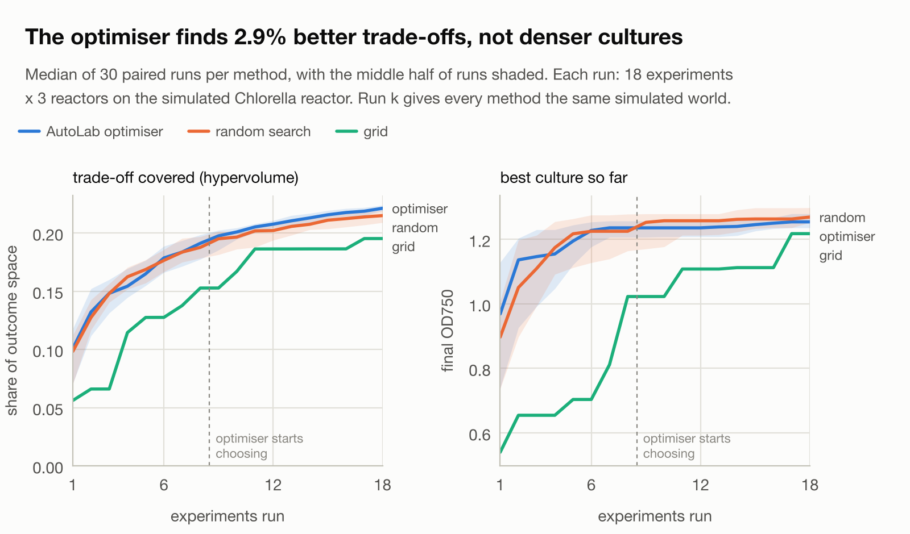
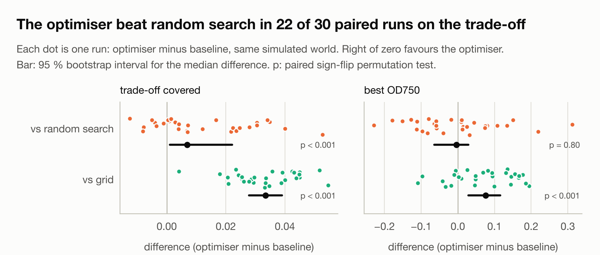

# Does AutoLab's optimiser beat random and grid search?

[Project overview](../README.md) · [Model](model.md) · [Architecture](architecture.md) · [Progress](progress.md)

**Short answer:** on the simulated *Chlorella* reactor, AutoLab's optimiser finds better trade-offs between growth, energy and CO₂ than random search, by 2.5 % (median). That's small but consistent: it was better in 22 of 30 paired runs. It does not find denser cultures than random search. It beats a fixed grid clearly on both counts. This is a result about a simulator, and the last section says why it may not hold on real hardware.

<picture>
  <source media="(prefers-color-scheme: dark)" srcset="images/benchmark-progress-dark.png">
  
</picture>

## The question

AutoLab chooses each culture's temperature, light and pH, aiming for high final OD750 at low energy and CO₂ use. Does its optimiser get there faster than simpler strategies, given the same small budget?

## How it was tested

- **Three methods, the same budget.** Each run is 18 experiments × 3 replicate reactors × 36 h.
  - **AutoLab optimiser:** 8 random start-up experiments, then Optuna's multi-objective TPE. The sampler is pinned to TPE.
  - **Random search:** AutoLab's `strategy: random`, uniform over the search space.
  - **Grid:** 3 temperatures (22, 28, 34 °C) × 3 light levels (60, 180, 400 µmol/m²/s) × 2 pH (6.5, 8.0), in AutoLab's lexicographic order. This uses the `grid_levels` option added to AutoLab for this benchmark.
- **30 paired runs.** Run *k* gives all three methods the same simulated world (device seed *k* + 1), so a difference within a pair comes from the strategy, not from luckier noise.
- **Independent seeds.** AutoLab seeds each trial's sampler with campaign seed + trial number, so neighbouring seeds would share most of their start-up designs. The seeds are spaced 1000 apart, more than the budget, and the pilot confirmed no two runs started alike.
- **No injected faults.** This measures search, not quality control. Every experiment passed QC.
- **Main score: hypervolume.** This is the share of the outcome space (OD750 up; energy and CO₂ down) that a run's results dominate. Hypervolume is the standard score for multi-objective search, and the optimiser was asked to optimise all three goals, so scoring on OD alone would be unfair to it.
  - The reference point comes from device limits only, never from results: OD 0; 7.2 kWh, the heater plus lights flat out for 36 h; and 36 g CO₂, the valve open for 36 h.
  - The ideal is the OD sensor's ceiling of 4.0.
- **Second score:** the best OD750 found, which is easier to read.
- **Statistics:** distribution-free, because 30 paired differences need not be normal.
  - A paired sign-flip permutation test (20,000 permutations, two-sided).
  - A 95 % bootstrap interval on the median paired difference.

Running 90 campaigns takes about 7 minutes on 8 cores.

## Results

| Optimiser vs | Score | Optimiser better in | Median difference (95 % CI) | Relative | p |
|---|---|---|---|---|---|
| random search | hypervolume | 22 / 30 | +0.0069 (+0.0011 to +0.0221) | +2.5 % | < 0.001 |
| random search | best OD750 | 15 / 30 | −0.004 (−0.064 to +0.028) | −0.3 % | 0.80 |
| grid | hypervolume | 30 / 30 | +0.033 (+0.028 to +0.039) | +13.4 % | < 0.001 |
| grid | best OD750 | 23 / 30 | +0.076 (+0.029 to +0.115) | +5.1 % | < 0.001 |

Relative differences are against the baseline's median. The three p-values below 0.001 stay below it after a Holm correction for the four tests. "< 0.001" means at or near the resolution of 20,000 permutations.

<picture>
  <source media="(prefers-color-scheme: dark)" srcset="images/benchmark-pairs-dark.png">
  
</picture>

## Sensitivity: fewer random start-up experiments

The optimiser spends its first 8 of 18 experiments sampling at random. Rerunning only the optimiser arm with 4 start-up experiments, against the same 30 worlds and the same random and grid results:

| Optimiser (4 start-up) vs | Score | Optimiser better in | Median difference (95 % CI) | Relative | p |
|---|---|---|---|---|---|
| random search | hypervolume | 25 / 30 | +0.015 (+0.009 to +0.022) | +5.5 % | < 0.001 |
| random search | best OD750 | 15 / 30 | +0.001 (−0.066 to +0.041) | +0.1 % | 0.99 |
| grid | hypervolume | 30 / 30 | +0.037 (+0.034 to +0.041) | +14.7 % | < 0.001 |
| grid | best OD750 | 26 / 30 | +0.080 (+0.064 to +0.093) | +5.4 % | < 0.001 |

The edge over random search roughly doubles, from 2.5 % to 5.5 %, and its interval moves further from zero. Comparing the two optimiser settings directly, run for run, 4 start-up experiments beat 8 in 14 of 30 runs (p = 0.13), so the improvement is suggestive rather than established. The 8-experiment setting stays the headline because it was chosen before the results were seen. Choosing the setting that happened to score best would overstate the effect.

Reproduce with `--startup 4` on both `run` (optimiser arm only) and `analyse`.

## What it means

- **The optimiser learns something, but late, and only about the trade-off.**
  - The curves overlap during the 8 random start-up experiments, as they should. Once the optimiser starts choosing, it pulls ahead on hypervolume and stays ahead.
  - It does this by finding conditions that use less energy and CO₂ for similar growth. That is what it was asked to do.
  - It doesn't find denser cultures than random search: both end near OD 1.57.
- **Random search is a strong baseline here.**
  - The growth surface is smooth, with a single broad peak (cardinal temperature, light and pH curves).
  - 18 experiments in three dimensions are enough for random points to land near it.
  - A 2.5 % edge is the honest size of the effect.
- **The grid is the weakest method, mostly by design.**
  - Its 18 points are fixed, so it can't move towards the optimum.
  - Its lexicographic order leaves its better points until late; its curves step up only after experiment 10.
  - Its best culture is limited by where its levels happen to fall.
  - A grid with a better order or better levels would do better. That's also what makes grids fragile.

## Limits: why this may not hold on real hardware

- **It's a simulator.** The growth model uses literature-typical *C. vulgaris* values ([model.md](model.md)) but is not validated against a real reactor. The response surface is smoother and better behaved than biology.
- **The noise is mild and well behaved:** Gaussian sensor noise and no drift between runs. Real cultures vary between inocula, batches of medium and seasons. That noise would blur small differences like the 2.5 % edge over random search.
- **There are no failures.** Real campaigns lose experiments to contamination, sensor faults and operator error, and every lost experiment costs a search method part of its budget.
- **One strain, one budget, one search space.** The result could change with more dimensions (nutrients, mixing), a bigger or smaller budget, or a different start-up share. Here 8 of 18 experiments are random, which limits how much the optimiser can learn.
- **The scoring depends on choices.** Hypervolume depends on the reference point. It was fixed from device limits before the runs, but other defensible choices would change the relative numbers, though not which method wins.
- **The grid was designed by hand.** Its levels and order are one reasonable design, not the best possible grid.
- **The optimiser runs with default settings.** TPE was not tuned, and a Gaussian-process sampler wasn't tested.

## Reproduce it

```sh
uv run python -m algae_sim.autolab.benchmark run runs/benchmark --runs 30 --workers 8
uv run python -m algae_sim.autolab.benchmark analyse runs/benchmark
```

The observations behind these numbers are in [benchmark/observations.jsonl](benchmark/observations.jsonl): every experiment's conditions and the replicate means the optimiser saw. The summary is in [benchmark/summary.json](benchmark/summary.json). Campaigns are deterministic, so the same code and pins give the same files. Code: `algae_sim/autolab/benchmark.py`. AutoLab is pinned at `26bfc8b`.
