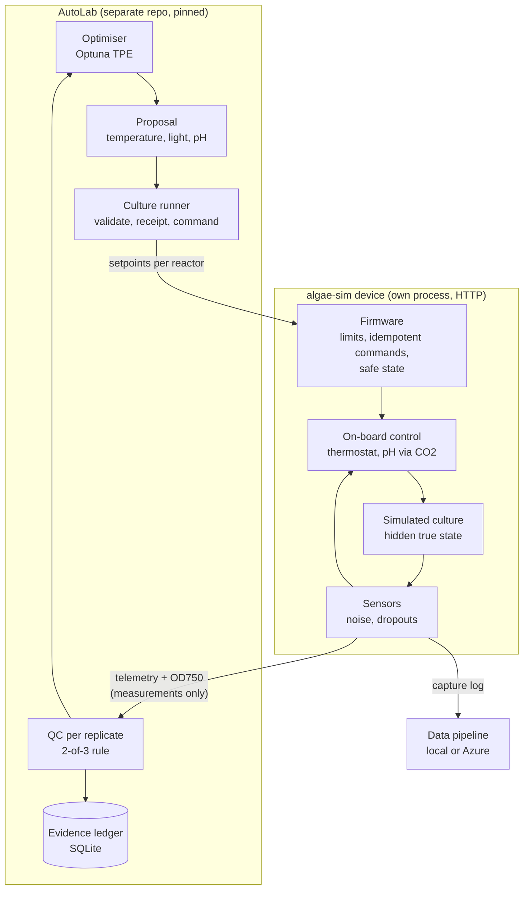
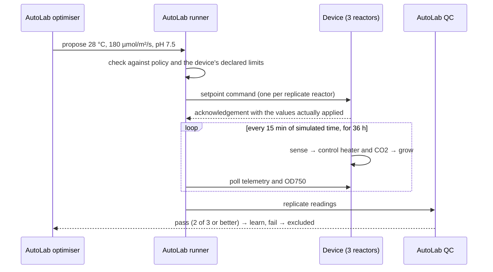
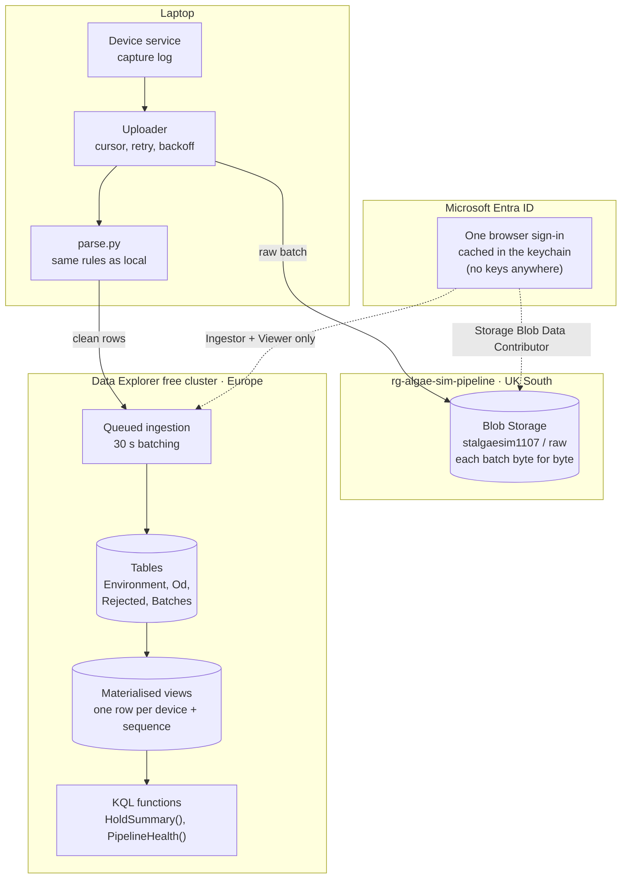

# Case study: a closed-loop lab, end to end, before any hardware exists

[Project overview](../README.md) · [Architecture](architecture.md) · [Model](model.md) · [Benchmark](benchmark.md) · [Validation](validation.md) · [Data pipeline](data-pipeline.md)

**In one paragraph:** I built a simulated algae photobioreactor that behaves like lab hardware, and drove it with [AutoLab](https://github.com/stev004/autolab), my closed-loop experimentation platform. AutoLab proposes growth conditions; the "device" holds them with its own control and safety; quality control rejects bad replicates; and the optimiser learns from the rest. The instrument data flows through a pipeline that runs both locally and on Azure. I grounded the growth model in published *Chlorella vulgaris* papers, then tested it against an independent experiment: it got the typical growth rate right but the temperature preference wrong, and I documented why rather than tuning it to pass. A benchmark of 90 campaigns shows the optimiser finds about 3 % better growth/energy/CO₂ trade-offs than random search. That's a small edge, honestly reported. The code was written by AI coding agents under my direction; I designed the system, set the requirements, and reviewed and tested every change.

## 1. The system

**The rules that shape it:**
- **Truth, measurement, decision and actuation are kept apart.** Only the simulator sees true temperature and biomass; everything else, including AutoLab, sees noisy sensor readings.
- **The device owns safety.** It refuses out-of-range commands itself, trips on over-temperature or low pH, and keeps holding safely if AutoLab or the network disappears.
- **AutoLab has no simulator-specific code.** The device plugs in through AutoLab's own controller and sensor contracts, as real hardware would. AutoLab did evolve during the project, gaining culture contract v2 for pH and a grid option for the benchmark, but as general features.

## 2. One experiment

- **Time:** a 36-hour culture runs in a fraction of a second on simulated time, so a 20-experiment campaign takes seconds.
- **Faults:** heater failures, culture crashes and stuck CO₂ valves can be injected into single replicates. AutoLab's QC catches each one; the [README](../README.md) lists them.
- **Reproducibility:** every run is seeded, and rerunning a campaign gives byte-identical evidence and charts.

## 3. Results

### Does the optimiser beat simpler strategies?

90 campaigns: AutoLab's optimiser, random search and a 3 × 3 × 2 grid, 30 paired runs each, 18 experiments per run. Run *k* gives every method the same simulated world, so differences come from the strategy, not from luckier noise. Full method and limits are in [benchmark.md](benchmark.md).

<picture>
  <source media="(prefers-color-scheme: dark)" srcset="images/benchmark-progress-dark.png">
  
</picture>

| Optimiser vs | Better trade-offs (hypervolume) | Denser cultures (best OD750) |
|---|---|---|
| Random search | **+2.9 %**, better in 22 of 30 runs, p < 0.001 | no difference (p = 0.31) |
| Grid | **+13.5 %**, better in 30 of 30, p < 0.001 | +2.7 %, p < 0.001 |

- **What the optimiser learns:** cheaper conditions for the same growth, which is what it's asked to do. It doesn't find denser cultures than random search.
- **The size of the edge:** small, because on this smooth simulated surface random search is a strong baseline.
- **Robustness:**
  - The result held when the growth model changed underneath it (before shading: +2.5 %).
  - With fewer random start-up experiments the edge grew to +3.6 %. That setting wasn't chosen in advance, so it isn't the headline.

### Is the growth model realistic?

- **Grounding:** parameters come from published *C. vulgaris* papers, read in full where possible, each cited with a confidence level ([model.md](model.md)).
- **The check:** the model was tested against an independent experiment (Pinto et al. 2026, 12 batch runs), with the rules fixed before running ([validation.md](validation.md)).

| | First check | After adding light self-shading |
|---|---|---|
| Runs within ±30 % on early growth | 0 of 12 | **9 of 12** (at an assumed 5 cm light path) |
| Typical growth rate, model ÷ measured | 2.1× | **1.05×** |
| Temperature ranking | backwards | still backwards: this strain prefers cooler conditions than the pooled literature values |

The failed first check was documented, not tuned away. The fix that followed, light shading, used a value from a *different* study, and what still doesn't fit is stated plainly.

### Does the data pipeline hold up?

| Check | Local | Azure |
|---|---|---|
| Messages from a 15-experiment campaign | about 10,000 | 10,035 lines, 22 batches, about 32 s |
| Bad lines quarantined with a reason | 3 | 3 (old schema, torn write, an impossible 412 °C) |
| Full replay of the log | 0 new rows | 20,264 rows stored, **10,032 unique** kept by the dedupe views |
| Per-hold report | matches AutoLab's QC verdicts | **identical to the local report on all 45 holds** |

## 4. The Azure setup

Built in the Azure portal by me, at **£0**: the free account's hard spending limit, plus the free Data Explorer cluster.

**Decisions, and what building it taught me:**
- **No Azure Function.** The free trial refuses the Flex Consumption plan, even though the docs imply otherwise, and the older plan is retired for Python. So the laptop uploader does the Function's job, and the parse rules are shared code, not a copy.
- **Queued, not streaming, ingestion.** The free cluster refused streaming writes (403) even with the right role. I diagnosed it by probing each write path with the same identity: reads, inline ingestion and queued ingestion worked, and streaming didn't.
- **Two identities, least privilege.** The Azure sign-in is a different principal from the Microsoft account that created the cluster, so it got explicit *Ingestor* and *Viewer* rights, nothing more. Permission errors now stop the uploader with the identity named, instead of retrying quietly.
- **Duplicates are expected, then removed.** Data Explorer accepts everything; materialised views keep the latest copy of each message, so resends and replays are harmless.

## 5. What I'd do next

- **A real reactor.** A jar of *Chlorella*, a heater, an LED panel and cheap sensors on a Raspberry Pi, behind the same device contract, so AutoLab wouldn't change at all. That's the one step that would turn "simulated" into "real".
- **A strain-specific temperature curve** and a nitrogen limit, each checked against a dataset it wasn't fitted to.

## Limits, stated plainly

- **Every result except the validation comes from a simulator.** Nothing here predicts real algae behaviour.
- **The benchmark is narrow:** one strain, one budget and one search space. Real hardware adds drift and failures that could erase a 3 % edge.
- **The Azure setup is a demonstration at demo scale:** one user, a free cluster with no SLA, and no production hardening.
